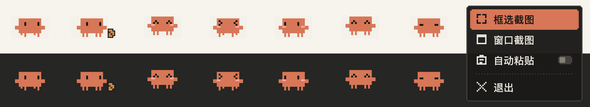

# ClawdSnip

一只住在屏幕角落的像素 Clawd，顺手帮你截图，并把截图粘贴进 Claude 桌面版的输入框。



> 这是个人做的非官方小工具，与 Anthropic 无关。

## 它能做什么

- **常驻最前的小悬浮窗**：Clawd 会自己散步、吃点心、东张西望、打盹；透明的地方点击会穿透，不挡字
- **悬停展开菜单**：鼠标移上去，Clawd 害羞地跳一下，弹出像素风菜单
- **一键截图**：单击 Clawd 直接框选截图
- **自动粘贴到 Claude**：Claude 窗口自动让开 → 框选 → 回到 Claude 并自动 ⌘V 粘贴进输入框；没开 Claude 时只复制到剪贴板
- **可拖动**：拖动 Clawd 换位置，会记住
- **省电**：大部分时间不刷新画面；锁屏、显示器睡眠、截图时完全停；低电量模式下只发呆和打盹

## 系统要求

- macOS（Apple 芯片和 Intel 都可以）
- Xcode 命令行工具（提供 Swift 编译器，**不需要**安装完整的 Xcode）
- 自动粘贴功能配合 [Claude 桌面版](https://claude.ai/download) 使用；不装 Claude 也能截图到剪贴板

## 安装

整个过程在「终端」App 里完成（启动台 → 其他 → 终端，或 Spotlight 搜"终端"）。

**1. 安装命令行工具**（装过的话会提示已安装，跳过即可）

```bash
xcode-select --install
```

**2. 下载源码**

```bash
git clone https://github.com/fwwwwjj/ClawdSnip.git
cd ClawdSnip
```

> 没有 git？在本页面点绿色的 **Code → Download ZIP**，解压后在终端里 `cd` 进解压出的文件夹，然后从第 3 步继续。

**3. 编译并安装**（装到 `~/Applications/ClawdSnip.app`，大约需要一分钟）

```bash
./build.sh
```

看到 `installed: .../ClawdSnip.app` 就成功了。编译时用单核、低优先级，避免电脑发热。

**4. 打开**

```bash
open ~/Applications/ClawdSnip.app
```

Clawd 会出现在屏幕右侧，并提示"Clawd 就位 · 悬停展开"。

## 第一次使用要开的权限

| 权限 | 用来做什么 | 在哪里开 |
| --- | --- | --- |
| 屏幕录制 | 截图 | 系统设置 → 隐私与安全性 → 屏幕与系统录音 |
| 辅助功能 | 截完图自动按 ⌘V 粘贴 | 系统设置 → 隐私与安全性 → 辅助功能 |

系统会在需要时弹窗询问，按提示打开即可。打开屏幕录制权限后如果仍然截不到其他窗口的内容，退出 ClawdSnip 再重新打开一次。

不想给辅助功能权限也没关系：截图照样会复制到剪贴板，自己按 ⌘V 粘贴就行。

> 建议在第一次 `./build.sh` 之前先运行一次 `./setup-signing.sh`：它会生成一个只在本机用的固定签名（放在单独的钥匙串文件里，不碰登录钥匙串），以后重新编译，系统授权也不会失效。不运行的话会用临时签名，每次重新编译后系统都可能要求重新授权。如果权限列表里还留着旧的 ClawdSnip，先选中它点"−"删掉，再重新打开应用授权。

## 使用方法

| 操作 | 效果 |
| --- | --- |
| 鼠标移到 Clawd 身上 | 弹出菜单 |
| 单击 Clawd | 框选截图 |
| 拖动 Clawd | 移动位置（会记住） |
| 截图时按 Esc | 取消，Claude 恢复原样 |
| 菜单 → 窗口截图 | 点选一个窗口截图 |
| 菜单 → 自动粘贴 | 开关；关掉后只复制到剪贴板，不自动粘贴 |
| 菜单 → 退出 | 退出 ClawdSnip |

## 开机自动启动

系统设置 → 通用 → 登录项与扩展 → 在"登录时打开"下点"＋"，选择个人文件夹里"应用程序"中的 ClawdSnip。

## 更新到新版本

```bash
cd ClawdSnip
git pull
./build.sh
```

## 卸载

先在菜单里点"退出"，然后在终端运行：

```bash
rm -rf ~/Applications/ClawdSnip.app
```

想同时清掉记住的位置和设置：

```bash
defaults delete local.fwj.ClawdSnip
```

最后到系统设置的"屏幕与系统录音"和"辅助功能"列表里把 ClawdSnip 删掉。

## 自己动手改

所有代码都在 `main.swift` 一个文件里：

- **加菜单功能**：改最上面的 `buildMenu()`，往数组里加一个 `MenuItem`
- **调散步范围 / 动画帧率**：改 `walkSlack` / `tickHz`
- **重新生成预览图**：`~/Applications/ClawdSnip.app/Contents/MacOS/ClawdSnip --render-preview docs/preview.png`

改完重新运行 `./build.sh` 即可。
